# Diagrama de secuencia – Cumplir Orden de Selección

Pantalla: `CumplirOrdenSeleccionForm` · Modelo: `CumplirOrdenSeleccionModelo` · Caso de uso: Cumplir orden de selección.

Convenciones:
- El diagrama sigue el código tal como está: cada mensaje es una invocación real (evento del formulario, método o propiedad del modelo, consulta a un almacén o acceso a un objeto).
- Las búsquedas en los almacenes las hace **el modelo**: las entidades no tienen métodos de búsqueda.
- Todo objeto sobre el que se actúa aparece como participante, y cada acción sobre él es un mensaje que le envía el modelo, con sus parámetros.
- Cada orden se obtiene con una invocación visible: el ciclo de los pasos 2 a 12 empieza siempre con `MostrarOrdenPendiente()` → `BuscarOrdenPendiente()`.
- `-->>` es el valor que devuelve la invocación.
- Los números de paso y de excepción son los del caso de uso.

```mermaid
sequenceDiagram
    autonumber
    actor O as Operario de Almacenamiento
    participant F as CumplirOrdenSeleccionForm
    participant MB as MessageBox
    participant M as CumplirOrdenSeleccionModelo
    participant OS as ordenActual : OrdenSeleccion
    participant II as stock : ItemInventario
    participant OA as OrdenesSeleccionAlmacen
    participant OSE as ordenEntidad : OrdenSeleccionEntidad
    participant MA as MercaderiasAlmacen
    participant ME as mercaderia : MercaderiaEntidad
    participant UM as ubicacion : UbicacionMercaderia
    participant PA as OrdenesPreparacionAlmacen
    participant OPE as ordenPreparacion : OrdenPreparacionEntidad
    participant OPP as preparacion : OrdenPreparacionEntidad
    participant RP as renglon : RenglonOrdenPreparacion
    participant RSE as existente : RenglonOrdenSeleccion

    %% ---------- Paso 1: abrir la pantalla ----------
    Note over O,OPE: Paso 1 · El operario abre la pantalla
    O->>F: Abre "Cumplir orden de selección"
    F->>M: new CumplirOrdenSeleccionModelo()
    M->>M: UsuarioActual = Environment.UserName
    M->>OA: OrdenesSeleccion
    OA-->>M: List<OrdenSeleccionEntidad>
    M->>M: OrdenesSeleccion = ordenes.Select(ConvertirOrden).ToList()
    Note right of M: ConvertirOrden(o) = new OrdenSeleccion(Numero, CodigoDeposito, Estado, FechaHoraCumplida, UsuarioCumplida,<br/>Renglones = OrdenarPorPosicion(o.Renglones, Posicion)<br/>.Select(new RenglonOrdenSeleccion(CodigoCliente, Posicion, Sku, Descripcion, Cantidad)))<br/>OrdenarPorPosicion compara pasillo, fila y nivel sin convertir texto a número
    M->>M: Inventario = new List<ItemInventario>()
    F->>F: CumplirOrdenSeleccionForm_Shown(sender, e)

    loop Pasos 2 a 12 · Por cada orden de selección pendiente (cada vuelta la inicia MostrarOrdenPendiente)
        F->>F: MostrarOrdenPendiente()

        %% ---------- Paso 2: buscar la orden pendiente ----------
        Note over O,OPE: Paso 2 · El sistema toma la orden de selección Pendiente de número más bajo
        F->>M: BuscarOrdenPendiente()

        %% ---------- Desencadenante: corte ----------
        Note over O,RSE: Desencadenante · Antes del paso 2, si ya pasó un horario de corte, el sistema genera las órdenes de selección
        M->>M: EjecutarCorteSiCorresponde()
        M->>M: corte = UltimoCorteProgramado(DateTime.Now)
        Note right of M: Último horario de HorariosCorte (08:00 y 14:00) que ya pasó:<br/>hoy o, antes de las 08:00, el de ayer a las 14:00
        opt Corte nuevo (ultimoCorteEjecutado < corte)
            M->>M: ultimoCorteEjecutado = corte
            M->>M: GenerarOrdenesSeleccion()
            M->>OA: OrdenesSeleccion
            OA-->>M: ordenesSeleccion
            M->>PA: OrdenesPreparacion.Where(Estado == Pendiente).OrderBy(FechaRetiro).ThenBy(Numero)
            PA-->>M: pendientes
            loop Por cada depósito (pendientes.GroupBy(CodigoDeposito))
                M->>OA: OrdenesSeleccion.Where(Estado == Pendiente, CodigoDeposito == deposito).SelectMany(Renglones)
                OA-->>M: renglones de las órdenes de selección pendientes del depósito
                M->>M: reservado[ClaveReserva(CodigoCliente, Sku, Posicion)] += Cantidad, por cada renglón
                create participant NOS as nueva : OrdenSeleccionEntidad
                M->>NOS: new OrdenSeleccionEntidad(CodigoDeposito = deposito, Estado = Pendiente)
                loop Por cada preparacion del depósito
                    M->>M: reservadoConEsta = new Dictionary(reservado), renglonesDeEsta = new List<RenglonOrdenSeleccion>(), alcanza = true
                    M->>OPP: Renglones
                    OPP-->>M: List<RenglonOrdenPreparacion>
                    loop Por cada renglon (mientras alcanza)
                        M->>RP: Sku, Cantidad, Producto
                        RP-->>M: SKU, cantidad pedida y descripción
                        M->>MA: Mercaderias.FirstOrDefault(CodigoCliente == preparacion.CodigoCliente, Sku == renglon.Sku, CodigoDeposito == deposito)
                        MA-->>M: mercaderia (o null)
                        M->>ME: Ubicaciones (si mercaderia no es null)
                        ME-->>M: List<UbicacionMercaderia> (vacía si no hay mercaderia)
                        M->>M: falta = renglon.Cantidad, ubicaciones = OrdenarPorPosicion(mercaderia.Ubicaciones, Posicion)
                        loop Por cada ubicacion (mientras falta > 0)
                            M->>UM: Posicion, Cantidad
                            UM-->>M: posición y unidades en guarda
                            M->>M: clave = ClaveReserva(preparacion.CodigoCliente, renglon.Sku, ubicacion.Posicion)<br/>libre = ubicacion.Cantidad - reservadoConEsta[clave]
                            opt libre > 0
                                M->>M: tomar = Math.Min(libre, falta)
                                M->>M: renglonesDeEsta.Add(new RenglonOrdenSeleccion(CodigoCliente = preparacion.CodigoCliente, Sku = renglon.Sku,<br/>Posicion = ubicacion.Posicion, Cantidad = tomar, Descripcion = renglon.Producto))
                                M->>M: reservadoConEsta[clave] += tomar, falta -= tomar
                            end
                        end
                        opt falta > 0 · No hay stock libre en las posiciones
                            M->>M: alcanza = false
                        end
                    end
                    alt alcanza == false
                        Note over M,OPP: La orden de preparación no entra en este corte y sigue Pendiente para el próximo
                    else Alcanza el stock para toda la orden de preparación
                        loop Por cada r de renglonesDeEsta
                            M->>NOS: Renglones.FirstOrDefault(CodigoCliente == r.CodigoCliente, Sku == r.Sku, Posicion == r.Posicion)
                            NOS-->>M: existente (o null)
                            alt No existe
                                M->>NOS: Renglones.Add(r)
                            else Ya hay un renglón con el mismo cliente, SKU y posición
                                M->>RSE: Cantidad += r.Cantidad
                            end
                        end
                        M->>M: reservado = reservadoConEsta
                        M->>OPP: Numero
                        OPP-->>M: número de la orden de preparación
                        M->>NOS: OrdenesPreparacion.Add(preparacion.Numero)
                        M->>OPP: Estado = EnPreparacion
                    end
                end
                M->>NOS: OrdenesPreparacion
                NOS-->>M: List<int> números de orden de preparación
                opt nueva.OrdenesPreparacion.Count > 0
                    M->>NOS: Numero = ordenesSeleccion.Max(Numero) + 1
                    M->>OA: OrdenesSeleccion.Add(nueva)
                    M->>M: generadas.Add(nueva)
                end
            end
            opt generadas.Count > 0
                M->>OA: Guardar()
                Note right of OA: Escribe Datos/OrdenesSeleccion.json
                M->>PA: Guardar()
                Note right of PA: Escribe Datos/OrdenesPreparacion.json
            end
            M->>M: OrdenesSeleccion.Add(ConvertirOrden(nueva)), por cada orden generada
        end
        Note right of M: ultimoCorteEjecutado es estático: vale mientras el programa está abierto.<br/>Si se reabre el programa, el último corte vuelve a correr

        M->>M: OrdenActual = OrdenesSeleccion.Where(Estado == Pendiente).OrderBy(Numero).FirstOrDefault()
        M->>M: Inventario.Clear()
        M->>MA: Mercaderias
        MA-->>M: List<MercaderiaEntidad>
        M->>M: DepositoActual
        opt Hay OrdenActual
            M->>OA: OrdenesSeleccion.First(Numero == OrdenActual.Numero)
            OA-->>M: ordenEntidad
            M->>OSE: CodigoDeposito
            OSE-->>M: código del depósito de la orden
        end
        M->>M: Inventario.AddRange(new ItemInventario(CodigoCliente, Sku, Posicion, Cantidad))<br/>por cada ubicación de las mercaderías con CodigoDeposito == DepositoActual
        M-->>F: null, o "No hay órdenes de selección pendientes"

        %% ---------- Paso 3: número y fecha ----------
        Note over O,OPE: Paso 3 · El sistema muestra el número de la orden y la fecha actual
        F->>M: NumeroOrdenActual
        M-->>F: número de la orden (o "-")
        F->>M: Fecha
        M-->>F: DateTime.Today
        F->>M: HayOrdenPendiente
        M-->>F: true / false
        F->>F: btnConfirmar.Enabled = HayOrdenPendiente, lvMercaderia.Items.Clear()

        break 2.1 · No hay órdenes pendientes (BuscarOrdenPendiente devolvió el mensaje)
            F->>MB: Show(mensaje, Text, MessageBoxButtons.OK, MessageBoxIcon.Information)
            F-->>O: Lista vacía y botón Confirmar deshabilitado. Termina el ciclo y el caso de uso
        end

        %% ---------- Paso 4: renglones ordenados por posición ----------
        Note over O,OPE: Paso 4 · El sistema muestra los renglones ordenados por posición (pasillo, fila y nivel)
        F->>M: RenglonesOrdenados
        M->>OS: Renglones
        OS-->>M: List<RenglonOrdenSeleccion> (ya ordenados por posición al cargar la orden)
        M-->>F: renglones ordenados
        F-->>O: Muestra Posición, SKU, Descripción y Cantidad

        %% ---------- Pasos 5 a 8: confirmar ----------
        Note over O,OPE: Paso 5 · El operario baja la mercadería y la lleva a Preparación<br/>(5.1 · Si falta o está dañada no confirma: la orden sigue Pendiente)
        O->>F: Paso 6 · Presiona "Confirmar entrega a Preparación"
        F->>F: btnConfirmar_Click(sender, e)
        F->>M: PreguntaConfirmacion
        M->>OS: Numero
        OS-->>M: número de la orden
        M-->>F: "¿Confirma que entregó a Preparación toda la mercadería de la orden de selección N° [nro]?"
        F->>MB: Show(pregunta, Text, MessageBoxButtons.YesNo, MessageBoxIcon.Question)
        Note right of MB: Paso 7
        alt 8.1 · El operario presiona No
            O->>MB: No
            MB-->>F: DialogResult.No
            F-->>O: No se guarda nada. La misma orden sigue en pantalla (vuelve al paso 5)
        else Paso 8 · El operario presiona Sí
            O->>MB: Sí
            MB-->>F: DialogResult.Yes
            F->>M: CumplirOrden()

            %% ---------- Validación de negocio: stock suficiente ----------
            Note over M,UM: Antes del paso 9 · Validación de negocio: cada posición tiene stock suficiente para su renglón
            M->>OA: OrdenesSeleccion.First(Numero == OrdenActual.Numero)
            OA-->>M: ordenAValidar (ordenEntidad)
            M->>OSE: Renglones
            OSE-->>M: List<RenglonOrdenSeleccion>
            loop Por cada renglón a validar
                M->>MA: Mercaderias.Where(CodigoCliente == renglon.CodigoCliente, Sku == renglon.Sku, CodigoDeposito == orden.CodigoDeposito)
                MA-->>M: mercaderia
                M->>ME: Ubicaciones.FirstOrDefault(Posicion == renglon.Posicion)
                ME-->>M: ubicacion (o null)
                M->>UM: Cantidad
                UM-->>M: unidades disponibles en la posición (0 si no existe)
            end
            alt 9.1 · En alguna posición no hay stock suficiente
                M-->>F: "No se puede cumplir la orden de selección N° [nro]: en la posición [posición] hay [cantidad] unidades de [SKU]<br/>y la orden pide [cantidad]. Avise al Jefe de Almacén. La orden sigue Pendiente"
                Note over M,OA: No se modifica ni se guarda nada
            else Hay stock suficiente en todas las posiciones

            %% ---------- Paso 9: la orden queda cumplida ----------
            Note over M,OS: Paso 9 · La orden queda Cumplida con fecha, hora y usuario
            M->>OS: Estado = Cumplida
            M->>OS: FechaHoraCumplida = DateTime.Now
            M->>OS: UsuarioCumplida = UsuarioActual

            %% ---------- Paso 10: resta del stock ----------
            Note over M,II: Paso 10 · Resta cada renglón del inventario en memoria (cliente, SKU y posición)
            M->>OS: Renglones
            OS-->>M: List<RenglonOrdenSeleccion>
            loop Por cada renglon
                M->>M: Inventario.FirstOrDefault(Cliente == renglon.Cliente, Sku == renglon.Sku, Posicion == renglon.Posicion)
                opt Existe en el inventario
                    M->>II: Cantidad -= renglon.Cantidad
                end
            end

            Note over M,OPE: Pasos 9 y 10 · Se guardan en los almacenes la orden cumplida y el stock<br/>(almacén Mercaderías: cliente, SKU y depósito de la orden, y la posición en sus ubicaciones)
            M->>OA: OrdenesSeleccion.First(Numero == OrdenActual.Numero)
            OA-->>M: ordenEntidad
            M->>OSE: Estado = Cumplida
            M->>OSE: FechaHoraCumplida = fecha y hora (sin milisegundos)
            M->>OSE: UsuarioCumplida = UsuarioActual
            M->>OSE: Renglones
            OSE-->>M: List<RenglonOrdenSeleccion>
            loop Por cada renglonEntidad
                M->>MA: Mercaderias.FirstOrDefault(CodigoCliente == renglonEntidad.CodigoCliente, Sku == renglonEntidad.Sku, CodigoDeposito == ordenEntidad.CodigoDeposito)
                MA-->>M: mercaderia
                M->>ME: Ubicaciones.FirstOrDefault(Posicion == renglonEntidad.Posicion)
                ME-->>M: ubicacion
                opt Existen mercaderia y ubicacion
                    M->>UM: Cantidad -= renglonEntidad.Cantidad
                    M->>UM: Cantidad
                    UM-->>M: cantidad que queda
                    opt La posición quedó vacía (Cantidad <= 0)
                        M->>ME: Ubicaciones.Remove(ubicacion)
                    end
                    M->>ME: CantidadFisica = Ubicaciones.Sum(Cantidad)
                    M->>ME: CantidadComprometida = Max(0, CantidadComprometida - renglonEntidad.Cantidad)
                    M->>ME: CantidadDisponible = CantidadFisica - CantidadComprometida
                end
            end
            Note over M,OPE: Paso 11 · Marca las órdenes de preparación de la selección como listas para empaquetar
            M->>OSE: OrdenesPreparacion
            OSE-->>M: List<int> números de orden de preparación
            M->>PA: OrdenesPreparacion.Where(Numero contenido en ordenEntidad.OrdenesPreparacion)
            PA-->>M: órdenes de preparación de la selección
            loop Por cada ordenPreparacion
                M->>OPE: OrdenSeleccionCumplida = true
            end
            Note right of OPE: Es el dato que consulta "Empaquetar pedido" para saber<br/>que la selección de la orden ya se cumplió
            M->>OA: Guardar()
            Note right of OA: Escribe Datos/OrdenesSeleccion.json
            M->>MA: Guardar()
            Note right of MA: Escribe Datos/Mercaderias.json
            M->>PA: Guardar()
            Note right of PA: Escribe Datos/OrdenesPreparacion.json
            M-->>F: "Orden de selección N° [nro] cumplida"
            end

            %% ---------- Paso 12 ----------
            F->>MB: Show(mensaje, Text, MessageBoxButtons.OK, MessageBoxIcon.Information)
            MB-->>O: Paso 12 · "Orden de selección N° [nro] cumplida" (o el mensaje de 9.1, y la orden vuelve a mostrarse)
            Note over F,M: Inicia la siguiente vuelta del ciclo: btnConfirmar_Click vuelve a invocar MostrarOrdenPendiente()
        end
    end

    %% ---------- Salida ----------
    opt Salida · Antes del paso 8
        O->>F: Cierra la pantalla
        Note right of F: No se invoca al modelo: no se guarda nada y la orden sigue Pendiente
    end
```

## Invocaciones por paso del caso de uso

| Paso / excepción | Evento o método del formulario | Invocaciones |
|---|---|---|
| 1 | Constructor y `CumplirOrdenSeleccionForm_Shown` | `new CumplirOrdenSeleccionModelo()` (lee `OrdenesSeleccionAlmacen` y arma `OrdenSeleccion` / `RenglonOrdenSeleccion` con `ConvertirOrden`) |
| Desencadenante (corte) | `MostrarOrdenPendiente` | `BuscarOrdenPendiente()` → `EjecutarCorteSiCorresponde()` → `UltimoCorteProgramado(DateTime.Now)` y, si el corte es nuevo, `GenerarOrdenesSeleccion()` → `OrdenesPreparacionAlmacen.OrdenesPreparacion`, `OrdenPreparacionEntidad.Renglones` / `Numero` / `Estado = EnPreparacion`, `MercaderiasAlmacen.Mercaderias`, `MercaderiaEntidad.Ubicaciones`, `new OrdenSeleccionEntidad`, `Renglones.Add`, `OrdenesSeleccion.Add`, `Guardar()` de los 2 almacenes; después `OrdenesSeleccion.Add(ConvertirOrden(nueva))` |
| 2 · 2.1 | `MostrarOrdenPendiente` (inicia cada vuelta del ciclo) | `BuscarOrdenPendiente()` → `MercaderiasAlmacen.Mercaderias`, `DepositoActual` (→ `OrdenesSeleccionAlmacen` y `OrdenSeleccionEntidad.CodigoDeposito`), arma `Inventario` |
| 3 | `MostrarOrdenPendiente` | `NumeroOrdenActual`, `Fecha`, `HayOrdenPendiente` |
| 4 | `MostrarOrdenPendiente` | `RenglonesOrdenados` → `OrdenSeleccion.Renglones` (ordenados por pasillo, fila y nivel al cargar la orden) |
| 9.1 | `btnConfirmar_Click` | `CumplirOrden()` → `OrdenesSeleccionAlmacen`, `OrdenSeleccionEntidad.Renglones`, `MercaderiasAlmacen.Mercaderias`, `MercaderiaEntidad.Ubicaciones`, `UbicacionMercaderia.Cantidad` (no guarda nada si falta stock) |
| 5 · 5.1 | (acción del operario fuera del sistema) | (ninguna) |
| 6 · 7 · 8 · 8.1 | `btnConfirmar_Click` | `PreguntaConfirmacion` → `OrdenSeleccion.Numero`, `MessageBox.Show(..., YesNo, Question)` |
| 9 | `btnConfirmar_Click` | `CumplirOrden()` → `OrdenSeleccion.Estado`, `FechaHoraCumplida`, `UsuarioCumplida` |
| 10 | `btnConfirmar_Click` | `CumplirOrden()` → `ItemInventario.Cantidad`, `OrdenSeleccionEntidad`, `MercaderiasAlmacen.Mercaderias`, `MercaderiaEntidad`, `UbicacionMercaderia` |
| 11 | `btnConfirmar_Click` | `CumplirOrden()` → `OrdenSeleccionEntidad.OrdenesPreparacion`, `OrdenPreparacionEntidad.OrdenSeleccionCumplida` y `Guardar()` de los 3 almacenes |
| 12 | `btnConfirmar_Click` | `MessageBox.Show(mensaje, ...)` y `MostrarOrdenPendiente()` (inicia la siguiente vuelta del ciclo) |
| Salida | (cerrar la ventana) | (ninguna) |
