# Diagrama de secuencia – Empaquetar pedido y generar orden de entrega

Pantalla: `EmpaquetarPedidoForm` · Modelo: `EmpaquetarPedidoModelo` · Caso de uso: Empaquetar pedido y generar orden de entrega.

Convenciones:
- Cada mensaje es una invocación de la pantalla: evento del formulario, método o propiedad del modelo, consulta a un almacén o acceso a un objeto.
- Las búsquedas en los almacenes las hace **el modelo**: las entidades no tienen métodos de búsqueda.
- Todo objeto sobre el que se actúa aparece como participante, y cada acción sobre él es un mensaje que le envía el modelo (o el formulario, si es un objeto de la pantalla), con sus parámetros.
- Cada orden se obtiene con una invocación visible: el ciclo de los pasos 2 a 13 empieza siempre con `TomarSiguienteOrden()`.
- `-->>` es el valor que devuelve la invocación.
- Los números de paso y de excepción son los del caso de uso.

```mermaid
sequenceDiagram
    autonumber
    actor O as Operario de Preparación
    participant F as EmpaquetarPedidoForm
    participant MB as MessageBox
    participant M as EmpaquetarPedidoModelo
    participant OP as ordenActual : OrdenPreparacion
    participant OPA as OrdenesPreparacionAlmacen
    participant OC as orden : OrdenPreparacionEntidad
    participant OPE as preparacionEntidad : OrdenPreparacionEntidad
    participant OEA as OrdenesEntregaAlmacen
    participant SFA as ServiciosFacturadosAlmacen

    %% ---------- Paso 1: abrir la pantalla ----------
    Note over O,SFA: Paso 1 · El operario abre la pantalla
    O->>F: Abre "Empaquetar pedido y generar orden de entrega"
    F->>M: new EmpaquetarPedidoModelo()
    M->>M: Usuario = Environment.UserName
    F->>F: EmpaquetarPedidoForm_Load(sender, e)

    loop Pasos 2 a 13 · Por cada orden lista para empaquetar (cada vuelta la inicia EmpaquetarPedidoForm_Load)
        F->>F: listViewProdPrep.Items.Clear()

        %% ---------- Paso 2: tomar la orden ----------
        Note over O,SFA: Paso 2 · Toma la orden En preparación cuya selección ya se cumplió, no tomada por otro puesto,<br/>de número más bajo, y la marca como tomada por el usuario
        F->>M: TomarSiguienteOrden()
        M->>OPA: OrdenesPreparacion
        OPA-->>M: List<OrdenPreparacionEntidad>
        loop Por cada orden de preparación
            M->>OC: Estado
            OC-->>M: estado de la orden
            M->>OC: OrdenSeleccionCumplida
            OC-->>M: true si su orden de selección ya está Cumplida
            M->>OC: TomadaPor
            OC-->>M: usuario que la tomó (o null)
            opt Estado == EnPreparacion, OrdenSeleccionCumplida == true y TomadaPor == null o TomadaPor == Usuario
                M->>M: candidatas.Add(new OrdenPreparacion(Numero, TipoPedido (según Modalidad), Transportista = EmpresaTransporte,<br/>OrdenSeleccionCumplida, Estado = EnPreparacion, FechaPreparada, PreparadaPor, TomadaPor,<br/>Renglones = new RenglonOrdenPreparacion(Sku, Cantidad)))
            end
        end
        Note right of OC: OrdenSeleccionCumplida = true lo guarda "Cumplir orden de selección"<br/>cuando el operario de Almacenamiento entrega la mercadería a Preparación
        M->>M: OrdenActual = candidatas.OrderBy(Numero).FirstOrDefault()
        opt Encontró una orden
            M->>OP: TomadaPor = Usuario
            M->>OPA: OrdenesPreparacion.First(Numero == OrdenActual.Numero)
            OPA-->>M: preparacionEntidad
            M->>OPE: TomadaPor = Usuario
            M->>OPA: Guardar()
            Note right of OPA: Queda tomada para los demás puestos (Datos/OrdenesPreparacion.json)
        end
        M-->>F: OrdenActual (o null)

        break 2.1 · No hay órdenes para preparar (TomarSiguienteOrden devolvió null)
            F->>F: OrdenPrepNro.Text = "Sin órdenes para preparar", buttonConfIEmp.Enabled = false
            F->>MB: Show("No hay órdenes para preparar", "Empaquetar pedido", MessageBoxButtons.OK, MessageBoxIcon.Information)
            F-->>O: Grilla vacía y botón deshabilitado. Termina el ciclo y el caso de uso
        end

        %% ---------- Paso 3: mostrar la orden ----------
        Note over O,SFA: Paso 3 · Muestra la orden tomada
        F->>OP: Numero
        OP-->>F: número de la orden
        F->>F: OrdenPrepNro.Text = "Orden de prep. N° [nro]", buttonConfIEmp.Enabled = true
        F->>OP: Renglones
        OP-->>F: List<RenglonOrdenPreparacion>
        loop Por cada renglon
            F->>OP: TipoPedido
            OP-->>F: TipoPedido
            F->>M: DescripcionTipoPedido(orden.TipoPedido)
            M-->>F: "Fulfillment" / "Palé cerrado"
            F->>F: listViewProdPrep.Items.Add(renglon.Sku, renglon.Cantidad, tipo de pedido)
        end
        F-->>O: Muestra Producto (SKU), Cantidad y Tipo de pedido

        %% ---------- Pasos 4 a 7: confirmar ----------
        Note over O,SFA: Paso 4 · El operario prepara la orden (fulfillment: empaqueta / palé cerrado: revisa sin desarmar)<br/>(4.1 · Si falta mercadería o está dañada no confirma y cierra la pantalla)
        O->>F: Paso 5 · Presiona "Confirmar ingreso"
        F->>F: buttonConfIEmp_Click(sender, e)
        F->>M: OrdenActual
        M-->>F: orden
        F->>OP: Numero
        OP-->>F: número de la orden
        F->>MB: Show("¿Confirma que la orden de preparación N° [nro] quedó empaquetada completa y desea generar la orden de entrega?",<br/>"Confirmar ingreso", MessageBoxButtons.YesNo, MessageBoxIcon.Question)
        Note right of MB: Paso 6
        alt 7.1 · El operario presiona No
            O->>MB: No
            MB-->>F: DialogResult.No
            F-->>O: No se guarda nada. La misma orden sigue en pantalla (vuelve al paso 5)
        else Paso 7 · El operario presiona Sí
            O->>MB: Sí
            MB-->>F: DialogResult.Yes
            F->>M: ConfirmarEmpaquetado()
            M->>OP: Renglones.Count
            OP-->>M: cantidad de renglones (> 0)

            %% ---------- Paso 8: orden de entrega ----------
            Note over M,OEA: Paso 8 · Registra la orden de entrega Pendiente
            M->>M: ahora = DateTime.Now
            M->>OEA: OrdenesEntrega
            OEA-->>M: List<OrdenEntregaEntidad> (para calcular Max(Numero) + 1)
            M->>OP: Numero
            OP-->>M: número de la orden de preparación
            M->>OP: Transportista
            OP-->>M: empresa de transporte
            create participant OE as ordenEntrega : OrdenEntrega
            M->>OE: new OrdenEntrega(Numero = Max(Numero) + 1, FechaHora = ahora, NumeroOrdenPreparacion = OrdenActual.Numero,<br/>Transportista = OrdenActual.Transportista, Usuario, Estado = Pendiente)
            M->>OPA: OrdenesPreparacion.First(Numero == OrdenActual.Numero)
            OPA-->>M: preparacionEntidad
            M->>M: fechaHora = ahora sin milisegundos
            M->>OPE: Renglones
            OPE-->>M: renglones (para CantidadPaquetes = Sum(Cantidad))
            M->>OPE: NombreTransportista
            OPE-->>M: nombre del transportista autorizado
            M->>OPE: DniTransportista
            OPE-->>M: DNI del transportista autorizado
            create participant OEE as entregaEntidad : OrdenEntregaEntidad
            M->>OEE: new OrdenEntregaEntidad(Numero = ordenEntrega.Numero, NumeroOrdenPreparacion, FechaHora = fechaHora, Usuario,<br/>CantidadPaquetes = Renglones.Sum(Cantidad), Estado = Pendiente, FechaHoraDespacho = null,<br/>NombreTransportista, DniTransportista)
            M->>OEA: OrdenesEntrega.Add(entregaEntidad)

            %% ---------- Paso 9: preparación Preparada ----------
            Note over M,OPE: Paso 9 · La orden de preparación queda Preparada con fecha, hora y usuario, y se libera
            M->>OPE: Estado = Preparada
            M->>OPE: FechaPreparada = fechaHora
            M->>OPE: PreparadaPor = Usuario
            M->>OPE: TomadaPor = null

            %% ---------- Paso 10: servicio facturado ----------
            Note over M,SFA: Paso 10 · Registra el servicio facturado de la orden (derecho a cobro)
            M->>SFA: ServiciosFacturados
            SFA-->>M: List<ServicioFacturadoEntidad> (para calcular Max(Numero) + 1)
            M->>OPE: CodigoCliente
            OPE-->>M: código del cliente
            M->>OPE: CodigoDeposito
            OPE-->>M: código del depósito
            M->>OPE: Modalidad
            OPE-->>M: PaletCerrado / Fulfillment
            create participant SFE as servicio : ServicioFacturadoEntidad
            M->>SFE: new ServicioFacturadoEntidad(Numero = Max(Numero) + 1, NumeroOrdenPreparacion, CodigoCliente, CodigoDeposito,<br/>FechaHora = fechaHora, Modalidad, Estado = PendienteDeFacturar, FechaHoraFacturado = null, Usuario)
            loop Por cada renglon de preparacionEntidad.Renglones
                M->>SFE: Detalle.Add(new RenglonServicioFacturado(renglon.Sku, renglon.Cantidad))
            end
            M->>SFA: ServiciosFacturados.Add(servicio)

            M->>OEA: Guardar()
            Note right of OEA: Escribe Datos/OrdenesEntrega.json
            M->>OPA: Guardar()
            Note right of OPA: Escribe Datos/OrdenesPreparacion.json
            M->>SFA: Guardar()
            Note right of SFA: Escribe Datos/ServiciosFacturados.json
            M->>OP: Estado = Preparada
            M->>OP: FechaPreparada = ahora
            M->>OP: PreparadaPor = Usuario
            M->>OP: TomadaPor = null
            M->>M: OrdenActual = null
            M-->>F: ordenEntrega

            %% ---------- Pasos 11 y 12: acciones manuales ----------
            Note over O,F: Pasos 11 y 12 · El operario imprime la orden de entrega (y en fulfillment la etiqueta del paquete)<br/>por fuera del sistema, pega la etiqueta y deja la mercadería en el área de despacho

            %% ---------- Paso 13 ----------
            F->>OE: Numero
            OE-->>F: número de la orden de entrega
            F->>MB: Show("Orden de entrega N° [nro] generada", "Confirmar ingreso", MessageBoxButtons.OK, MessageBoxIcon.Information)
            MB-->>O: Paso 13 · "Orden de entrega N° [nro] generada"
            F->>F: EmpaquetarPedidoForm_Load(sender, e)
            Note over F,M: Inicia la siguiente vuelta del ciclo: limpia la grilla y vuelve a invocar TomarSiguienteOrden()
        end
    end

    %% ---------- Cierre de la pantalla ----------
    opt Excepción · El operario cierra la pantalla en cualquier momento (incluye 4.1 y la salida antes del paso 7)
        O->>F: Cierra la pantalla
        F->>F: EmpaquetarPedidoForm_FormClosing(sender, e)
        F->>M: OrdenActual
        M-->>F: orden (o null)
        opt Hay una orden en pantalla
            F->>OP: Numero
            OP-->>F: número de la orden
            F->>MB: Show("¿Desea salir? La orden N° [nro] quedará disponible para otro puesto", "Salir",<br/>MessageBoxButtons.YesNo, MessageBoxIcon.Question, MessageBoxDefaultButton.Button2)
            alt Presiona No
                MB-->>F: DialogResult.No
                F->>F: e.Cancel = true
                F-->>O: Vuelve al paso en que estaba
            else Presiona Sí
                MB-->>F: DialogResult.Yes
                F->>M: LiberarOrdenActual()
                M->>OP: TomadaPor = null
                M->>OPA: OrdenesPreparacion.First(Numero == OrdenActual.Numero)
                OPA-->>M: preparacionEntidad
                M->>OPE: TomadaPor = null
                M->>OPA: Guardar()
                Note right of OPA: Escribe Datos/OrdenesPreparacion.json
                M->>M: OrdenActual = null
                F-->>O: La orden sigue En preparación y queda liberada. Termina el caso de uso
            end
        end
    end
```

## Invocaciones por paso del caso de uso

| Paso / excepción | Evento del formulario | Invocaciones |
|---|---|---|
| 1 | Constructor y `EmpaquetarPedidoForm_Load` | `new EmpaquetarPedidoModelo()` (`Usuario = Environment.UserName`) |
| 2 · 2.1 | `EmpaquetarPedidoForm_Load` (inicia cada vuelta del ciclo) | `TomarSiguienteOrden()` → `OrdenesPreparacionAlmacen.OrdenesPreparacion`, por cada orden `Estado`, `OrdenSeleccionCumplida` y `TomadaPor`, arma `OrdenPreparacion`, `OrdenPreparacion.TomadaPor`, `OrdenPreparacionEntidad.TomadaPor`, `OrdenesPreparacionAlmacen.Guardar()` |
| 3 | `EmpaquetarPedidoForm_Load` | `OrdenPreparacion.Numero`, `Renglones`, `TipoPedido`, `DescripcionTipoPedido(tipoPedido)` |
| 4 · 4.1 | (acción del operario; 4.1 sigue por el cierre de pantalla) | (ninguna) |
| 5 · 6 · 7 · 7.1 | `buttonConfIEmp_Click` | `OrdenActual`, `OrdenPreparacion.Numero`, `MessageBox.Show(..., YesNo, Question)` |
| 8 | `buttonConfIEmp_Click` | `ConfirmarEmpaquetado()` → `OrdenesEntregaAlmacen.OrdenesEntrega`, `new OrdenEntrega`, `OrdenesPreparacionAlmacen.OrdenesPreparacion.First`, `OrdenPreparacionEntidad` (Renglones, NombreTransportista, DniTransportista), `new OrdenEntregaEntidad`, `OrdenesEntrega.Add` |
| 9 | `buttonConfIEmp_Click` | `ConfirmarEmpaquetado()` → `OrdenPreparacionEntidad` (Estado, FechaPreparada, PreparadaPor, TomadaPor), `OrdenPreparacion` (Estado, FechaPreparada, PreparadaPor, TomadaPor) |
| 10 | `buttonConfIEmp_Click` | `ConfirmarEmpaquetado()` → `ServiciosFacturadosAlmacen.ServiciosFacturados`, `OrdenPreparacionEntidad` (CodigoCliente, CodigoDeposito, Modalidad), `new ServicioFacturadoEntidad`, `Detalle.Add(new RenglonServicioFacturado)`, `ServiciosFacturados.Add`, `Guardar()` de los 3 almacenes |
| 11 · 12 | (acciones manuales del operario) | (ninguna) |
| 13 | `buttonConfIEmp_Click` | `OrdenEntrega.Numero`, `MessageBox.Show(...)`, `EmpaquetarPedidoForm_Load` (inicia la siguiente vuelta del ciclo) |
| Cierre de pantalla | `EmpaquetarPedidoForm_FormClosing` | `OrdenActual`, `OrdenPreparacion.Numero`, `MessageBox.Show(..., YesNo, Question, Button2)`, `LiberarOrdenActual()` → `OrdenPreparacionEntidad.TomadaPor = null`, `OrdenesPreparacionAlmacen.Guardar()` |
