# Diagrama de secuencia – Registrar Orden de Preparación

Pantalla: `RegistrarOrdenDePreparacionForm` · Modelo: `RegistrarOrdenDePreparacionModelo` · Caso de uso 4.

Convenciones:
- Cada mensaje es una invocación real del código: evento del formulario, método o propiedad del modelo, consulta a un almacén o acceso a un objeto.
- Las búsquedas en los almacenes las hace **el modelo**: las entidades no tienen métodos de búsqueda.
- Todo objeto sobre el que se actúa aparece como participante, y cada acción sobre él es un mensaje que le envía el modelo, con sus parámetros.
- `-->>` es el valor que devuelve la invocación.
- Los números de paso y de excepción son los del caso de uso.

```mermaid
sequenceDiagram
    autonumber
    actor C as Cliente
    participant F as RegistrarOrdenDePreparacionForm
    participant MB as MessageBox
    participant M as RegistrarOrdenDePreparacionModelo
    participant SP as stock : StockProducto
    participant CA as ClientesAlmacen
    participant PA as ProductosAlmacen
    participant DA as DepositosAlmacen
    participant MA as MercaderiasAlmacen
    participant ME as mercaderia : MercaderiaEntidad
    participant OA as OrdenesPreparacionAlmacen

    %% ---------- Paso 1: abrir la pantalla ----------
    Note over C,OA: Paso 1 · El sistema muestra la pantalla con el nombre del cliente loggeado
    C->>F: Abre "Registrar Orden de Preparación"
    F->>M: new RegistrarOrdenDePreparacionModelo()
    M->>CA: Clientes
    CA-->>M: cliente loggeado
    M->>M: NombreCliente = cliente.RazonSocial
    M->>PA: Productos.Where(CodigoCliente == cliente.Codigo)
    PA-->>M: productos del cliente
    M->>M: new Producto(Sku, Descripcion, StockMinimoContratado) por cada producto
    M->>DA: Depositos
    DA-->>M: List<DepositoEntidad>
    loop Por cada depósito
        M->>MA: Mercaderias.Where(CodigoCliente == cliente.Codigo, CodigoDeposito == deposito.Codigo)
        MA-->>M: stock del cliente en el depósito
        opt El cliente tiene stock en el depósito
            M->>M: Depositos.Add(new Deposito(Nombre, Stock = new StockProducto(producto, CantidadDisponible)))
        end
    end
    F->>F: RegistrarOrdenDePreparacionForm_Load(sender, e)
    F->>M: NombreCliente
    M-->>F: razón social
    F->>M: Depositos
    M-->>F: List<Deposito>
    F->>M: FechaMinimaRetiro
    M-->>F: DateTime.Today
    F->>M: FechaRetiro
    M-->>F: DateTime.Today
    F->>F: radiomodalidad_CheckedChanged(sender, e)
    F->>M: SeleccionarModalidad(null)
    M-->>F: null
    F->>M: RequiereDatosEtiquetado
    M-->>F: false
    F-->>C: Muestra cliente y depósitos, oculta Datos para el Etiquetado

    %% ---------- Paso 2: depósito ----------
    Note over C,OA: Paso 2 · El cliente selecciona el depósito
    C->>F: Selecciona un depósito (combodepo)
    F->>F: combodepo_SelectedIndexChanged(sender, e)
    F->>M: SeleccionarDeposito(combodepo.SelectedItem as Deposito)
    alt Primer depósito elegido
        M->>M: DepositoSeleccionado = deposito
        M-->>F: null
    else Excepciones 2.1 / 2.2 · Cambia un depósito ya elegido
        M->>M: DepositoSeleccionado = deposito
        M->>M: ItemsOrden.Clear()
        M-->>F: "Se cambió el depósito, la orden actual ha sido reiniciada"
    end
    F->>M: ProductosDisponibles
    M-->>F: List<Producto> del depósito
    F->>F: Recarga "Productos a retirar" y limpia la orden
    opt Hubo mensaje (2.1 / 2.2)
        F->>MB: Show(mensaje, Text, MessageBoxButtons.OK, MessageBoxIcon.Information)
        Note right of F: Los demás datos ingresados se mantienen (2.2)
    end

    %% ---------- Pasos 3 y 4: modalidad ----------
    Note over C,OA: Pasos 3 y 4 · El cliente elige la modalidad de empaquetado
    C->>F: Marca "Palet Cerrado" o "Fullfilment"
    F->>F: radiomodalidad_CheckedChanged(sender, e)
    F->>M: SeleccionarModalidad(modalidad)
    alt Orden vacía o misma modalidad
        M->>M: Modalidad = modalidad
        M-->>F: null
    else Ya había productos en la orden
        M->>M: Modalidad = modalidad
        M->>M: ItemsOrden.Clear()
        M-->>F: "Se cambió la modalidad de empaquetado, la orden actual ha sido reiniciada"
        F->>MB: Show(mensaje, Text, MessageBoxButtons.OK, MessageBoxIcon.Information)
    end
    F->>M: RequiereDatosEtiquetado
    alt 4.1 · Fullfilment
        M-->>F: true
        F-->>C: Muestra Datos para el Etiquetado
    else 4.2 · Palet Cerrado
        M-->>F: false
        F-->>C: Oculta Datos para el Etiquetado
    end

    %% ---------- Pasos 5 a 10: productos ----------
    loop Pasos 5 a 10 · Por cada producto que se agrega
        C->>F: Elige producto e ingresa "Cantidad a Retirar"
        Note right of F: textsolonumeros_KeyPress / TextChanged:<br/>el formulario solo deja escribir dígitos
        C->>F: Presiona "Agregar a la Orden"
        F->>F: btnagregar_Click(sender, e)
        F->>F: cantidad = int.TryParse(textcantretirar.Text) (int? tipado)
        alt Validación de datos · No hay modalidad elegida
            F->>MB: Show("Error: seleccione una modalidad de empaquetado antes de agregar productos", Text,<br/>MessageBoxButtons.OK, MessageBoxIcon.Error)
        else Validación de datos · Falta depósito o producto, o la cantidad no es mayor a cero
            F->>MB: Show("Error: seleccione un producto e ingrese una cantidad mayor a cero", Text,<br/>MessageBoxButtons.OK, MessageBoxIcon.Error)
        else Datos válidos
            F->>M: AgregarProducto(comboprodretirar.SelectedItem as Producto, cantidad)
            Note right of M: Paso 8 · Validación de negocio: que la cantidad exista en el stock del depósito<br/>(el modelo conserva los controles de datos como segunda barrera)
            M->>M: DepositoSeleccionado.Stock.Find(Producto == producto)
            alt Palet Cerrado
                M->>SP: CantidadPalets
                SP-->>M: palets disponibles
            else Fullfilment
                M->>SP: CantidadUnidades
                SP-->>M: unidades disponibles
            end
            alt 8.1 · Stock insuficiente
                M-->>F: "Error: Stock insuficiente"
                F->>MB: Show(error, Text, MessageBoxButtons.OK, MessageBoxIcon.Error)
            else Paso 9 · Stock suficiente
                M->>M: ItemsOrden.Add(new ItemOrden(producto, cantidad)) o item.Cantidad += cantidad
                M-->>F: null
                F->>M: ItemsOrden
                M-->>F: List<ItemOrden>
                F->>M: UnidadDeCantidad
                M-->>F: "palets" (Palet Cerrado) / "unidades" (Fullfilment)
                F-->>C: Paso 10 · Muestra SKU, Producto y Cantidad
            end
        end
    end

    %% ---------- Pasos 11 a 13: datos de retiro ----------
    Note over C,OA: Pasos 11 a 13 · Fecha de retiro, etiquetado y transportista
    C->>F: Elige la fecha (datefecha)
    C->>F: Escribe Nombre del Destinatario / Nombre del transportista
    F->>F: textsololetras_KeyPress(sender, e)
    F->>M: EsCaracterValidoParaNombre(e.KeyChar)
    M-->>F: true / false
    F->>F: textsololetras_TextChanged(sender, e)
    F->>M: QuitarCaracteresInvalidosDeNombre(textBox.Text)
    M-->>F: texto filtrado
    C->>F: Escribe Dirección, DNI y Empresa de transporte
    Note right of F: El DNI usa textsolonumeros (solo dígitos)

    %% ---------- Pasos 14 a 16: confirmar ----------
    Note over C,OA: Paso 14 · El cliente confirma la orden
    C->>F: Presiona "Confirmar Orden"
    F->>F: btnconfirmar_Click(sender, e)
    F->>F: dni = int.TryParse(textDNI.Text) (int? tipado)
    F->>M: RequiereDatosEtiquetado
    M-->>F: true si es Fullfilment (regla de negocio: los datos de etiquetado son obligatorios)
    alt 13.1 · Validación de datos · Falta un campo obligatorio
        F->>MB: Show("Error: por favor rellene todos los campos antes de completar la orden", Text,<br/>MessageBoxButtons.OK, MessageBoxIcon.Error)
    else 13.3 · Validación de datos · El DNI no tiene 7 u 8 dígitos
        F->>MB: Show("Error: el DNI del transportista debe tener 7 u 8 dígitos", Text,<br/>MessageBoxButtons.OK, MessageBoxIcon.Error)
    else Datos válidos
    F->>M: FechaRetiro = datefecha.Value
    F->>M: NombreDestinatario = textnombre.Text
    F->>M: DireccionDestino = textdireccion.Text
    F->>M: NombreTransportista = textnomtrans.Text
    F->>M: DniTransportista = dni
    F->>M: EmpresaTransportista = textempresatrans.Text
    F->>M: ValidarOrden()
    Note right of M: Validación de negocio (el modelo conserva el control de campos como segunda barrera)
    alt 13.2 · La orden no tiene productos
        M-->>F: "Error: la orden de preparación debe contener al menos 1 producto"
        F->>MB: Show(error, Text, MessageBoxButtons.OK, MessageBoxIcon.Error)
    else Orden válida
        M-->>F: null
        F->>M: RegistrarOrden()
        loop Por cada item de ItemsOrden
            M->>M: DepositoSeleccionado.Stock.Find(Producto == item.Producto)
            alt Palet Cerrado
                M->>SP: CantidadPalets -= item.Cantidad
            else Fullfilment
                M->>SP: UnidadesSueltas -= item.Cantidad (abre palets si hace falta)
            end
            Note right of M: Paso 15 · Valida el stock mínimo contratado
            M->>SP: CantidadUnidades
            SP-->>M: unidades que quedan
            opt 15.2.1 · Quedó por debajo de item.Producto.StockMinimoContratado
                M->>M: mensajes.Add("Advertencia: El producto " + item.Producto.Nombre + " ha quedado por debajo del límite establecido...")
            end
        end
        Note right of M: 15.1 · Sin mínimo contratado no hay advertencia
        M->>CA: Clientes.First(RazonSocial == NombreCliente)
        CA-->>M: cliente loggeado
        M->>DA: Depositos.First(Nombre == DepositoSeleccionado.Nombre)
        DA-->>M: deposito
        M->>OA: OrdenesPreparacion
        OA-->>M: ordenes (para calcular Max(Numero) + 1)
        create participant OE as ordenEntidad : OrdenPreparacionEntidad
        M->>OE: new OrdenPreparacionEntidad(Numero, cliente.Codigo, deposito.Codigo, Modalidad, FechaRetiro, NombreDestinatario, DireccionDestino, NombreTransportista, DniTransportista, EmpresaTransportista, Estado = Pendiente, OrdenSeleccionCumplida = false, RequiereDatosEtiquetado)
        loop Por cada item de ItemsOrden
            M->>OE: Renglones.Add(new RenglonOrdenPreparacion(item.Producto.Sku, item.Cantidad, item.Producto.Nombre))
            M->>MA: Mercaderias.First(CodigoCliente == cliente.Codigo, CodigoDeposito == deposito.Codigo, Sku == item.Producto.Sku)
            MA-->>M: mercaderia
            M->>ME: CantidadComprometida += item.Cantidad
            M->>ME: CantidadDisponible = CantidadFisica - CantidadComprometida
        end
        M->>OA: OrdenesPreparacion.Add(ordenEntidad)
        M->>OA: Guardar()
        Note right of OA: Escribe Datos/OrdenesPreparacion.json
        M->>MA: Guardar()
        Note right of MA: Escribe Datos/Mercaderias.json
        M->>M: mensajes.Add("Orden de preparación guardada con éxito")
        M->>M: Limpia la orden en curso (DepositoSeleccionado, Modalidad, ItemsOrden y datos de retiro)
        M-->>F: List<string> mensajes
        loop Por cada mensaje (advertencias 15.2.1 y paso 16)
            F->>MB: Show(mensaje, Text, MessageBoxButtons.OK, MessageBoxIcon.Information)
            MB-->>C: "Orden de preparación guardada con éxito"
        end
        F->>F: Limpia los controles (combodepo.SelectedIndex = -1)
        F->>F: combodepo_SelectedIndexChanged(sender, e)
        F->>M: SeleccionarDeposito(null)
        M-->>F: null
        F->>M: ProductosDisponibles
        M-->>F: lista vacía
        F->>M: FechaRetiro
        M-->>F: DateTime.Today
    end
    end

    %% ---------- Salida ----------
    opt Salida · En cualquier momento
        C->>F: Presiona "Cancelar"
        F->>F: btncancelar_Click(sender, e)
        F->>F: Close()
    end
```

## Invocaciones por paso del caso de uso

| Paso / excepción | Evento del formulario | Invocaciones |
|---|---|---|
| 1 | Constructor y `RegistrarOrdenDePreparacionForm_Load` | `new RegistrarOrdenDePreparacionModelo()` (lee `ClientesAlmacen`, `ProductosAlmacen`, `DepositosAlmacen` y `MercaderiasAlmacen`), `NombreCliente`, `Depositos`, `FechaMinimaRetiro`, `FechaRetiro`, `SeleccionarModalidad(null)`, `RequiereDatosEtiquetado` |
| 2 · 2.1 · 2.2 | `combodepo_SelectedIndexChanged` | `SeleccionarDeposito(deposito)`, `ProductosDisponibles` |
| 3 · 4 · 4.1 · 4.2 | `radiomodalidad_CheckedChanged` | `SeleccionarModalidad(modalidad)`, `RequiereDatosEtiquetado` |
| 5 a 10 · 8.1 | `btnagregar_Click` | El formulario valida modalidad, producto y cantidad; después `AgregarProducto(producto, cantidad)` → `StockProducto.CantidadPalets` / `CantidadUnidades`, `ItemsOrden`, `UnidadDeCantidad` |
| 11 a 13 | `textsololetras_KeyPress` / `TextChanged` | `EsCaracterValidoParaNombre(caracter)`, `QuitarCaracteresInvalidosDeNombre(texto)` |
| 14 · 13.1 · 13.2 · 13.3 | `btnconfirmar_Click` | El formulario valida los datos (campos obligatorios según `RequiereDatosEtiquetado`, DNI de 7 u 8 dígitos); después asigna `FechaRetiro`, `NombreDestinatario`, `DireccionDestino`, `NombreTransportista`, `DniTransportista`, `EmpresaTransportista` y llama a `ValidarOrden()` |
| 15 · 15.1 · 15.2 · 15.2.1 · 16 | `btnconfirmar_Click` | `RegistrarOrden()` → `StockProducto`, `new OrdenPreparacionEntidad`, `Renglones.Add`, `MercaderiaEntidad.CantidadComprometida` / `CantidadDisponible`, `OrdenesPreparacion.Add`, `OrdenesPreparacionAlmacen.Guardar()` y `MercaderiasAlmacen.Guardar()` |
| Salida | `btncancelar_Click` | (ninguna) `Close()` |
